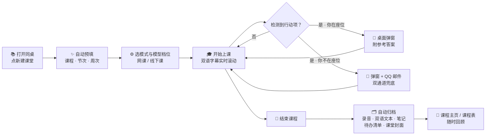
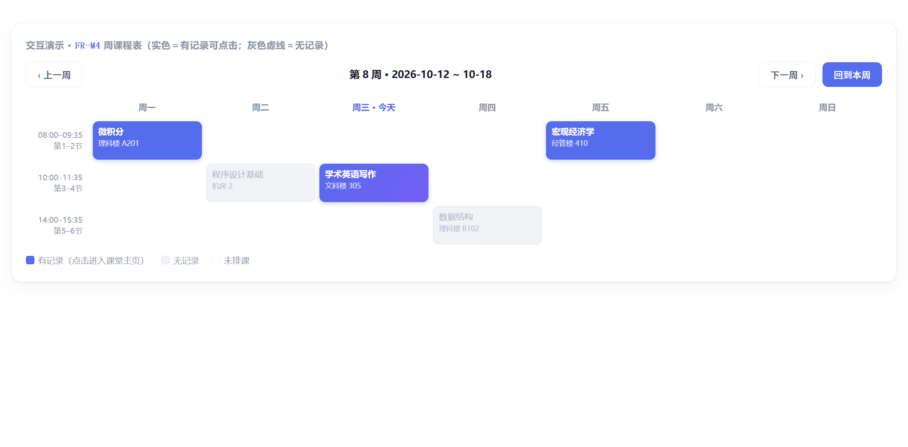
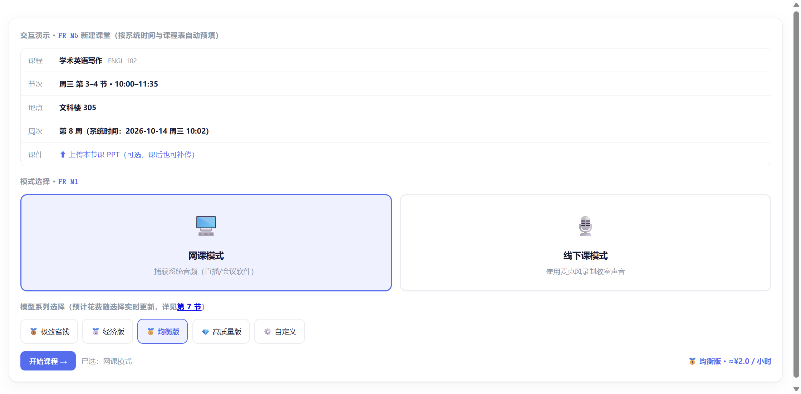
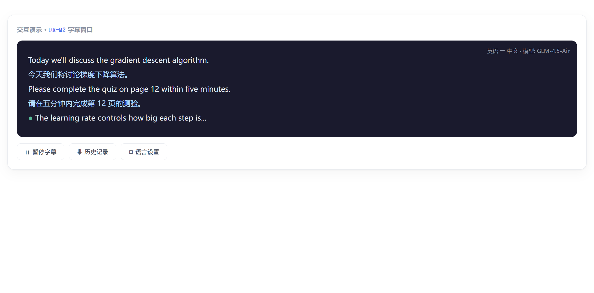
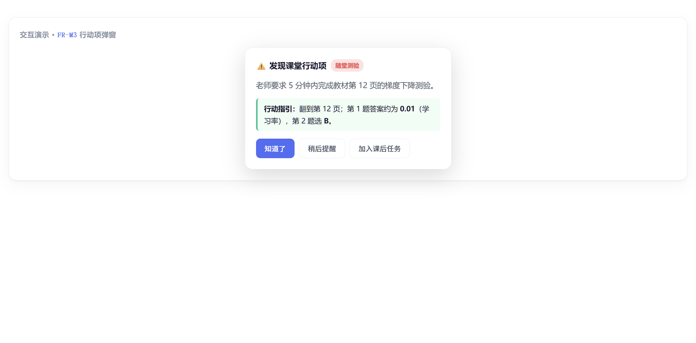
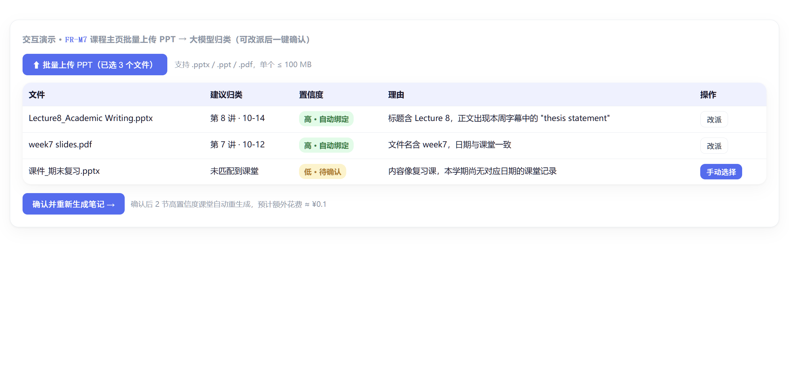
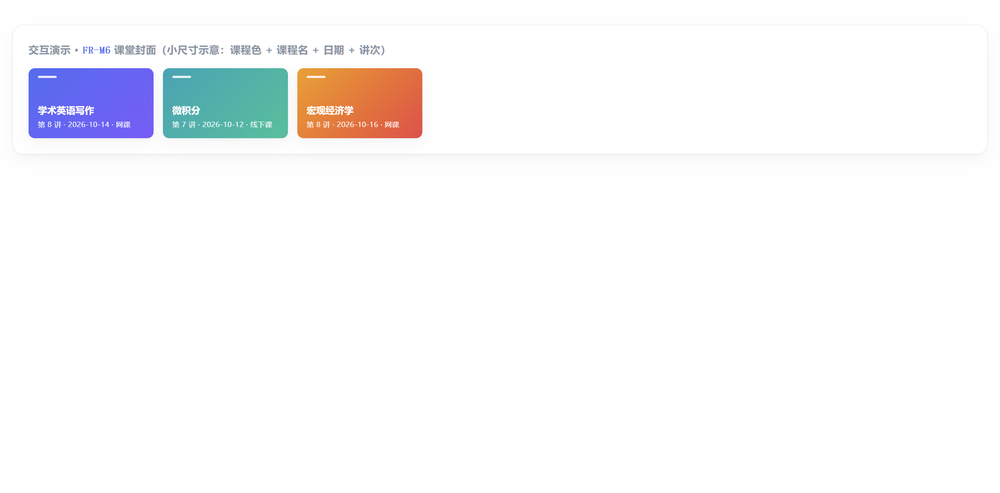
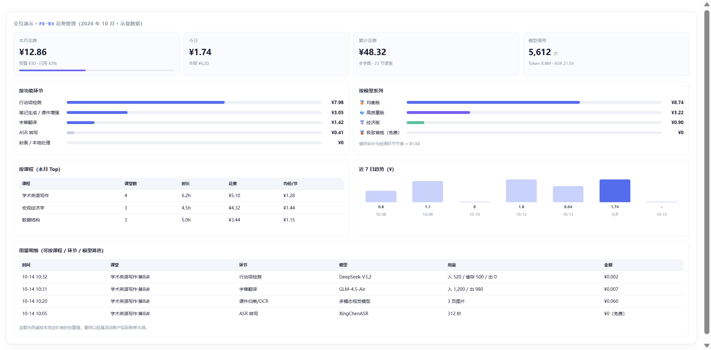

# 同桌（Deskmate）

> 面向留学生的智能桌面学习伴侣 —— 网课 / 线下课双语字幕与课堂任务管家
>
> Windows 桌面软件 · 听课语言障碍、随堂互动易错过、复习资料分散，一个"同桌"全兜住

---

## 这是什么

留学生在英语授课环境里常遇到三件事：

1. **听不懂** —— 老师语速快、口音重，一走神就跟不上
2. **会错过** —— 随堂测验、课堂提问、作业布置，藏在一大段讲授里一闪而过
3. **顾不上** —— 中途离开座位接水、上厕所，回来时根本不知道老师布置了什么

「同桌」就是坐在你旁边的那个 AI 同桌：它帮你**实时听写翻译**、**盯着老师有没有布置任务**、**你不在座位时替你听**、下课后把**录音、双语字幕、笔记、待办清单**整整齐齐归档好。

核心承诺：**一节课结束，你手上已经有了这节课的全部资料；课中需要你动手的时刻，同桌一定提醒你。**

## 一节课的完整旅程

## 两种听课模式

| 模式 | 适用场景 | 声音来源 |
|---|---|---|
| **网课模式** | Zoom / Teams / 录播课 | 直接捕获系统播放的声音（可指定只录某个应用） |
| **线下课模式** | 教室现场上课 | 笔记本麦克风录制教室声音 |

> 线下课小贴士：如果用的是带"英特尔智音技术"的麦克风阵列，同桌已内置绕过方案（RAW 采集模式），即使系统开启了"音频增强"降噪，也能正常收到老师讲课和同学发言的声音。

## 主要功能一览

### 课程管理
按"课程 → 课堂"两级归档整个学期。新建课程时填课程名、代码、地点、每周上课时间（可有多段）、起止周；每节课结束后自动生成一张简洁的课堂封面，课程主页一眼看全。

### 周课程表
按真实课表展示每周安排：有记录的课用实色高亮、点击直达课堂主页；没记录的灰色虚线。默认定位本周，可前后翻周。

### 新建课堂：一键开课
根据系统时间自动匹配"现在是哪门课、第几节、第几周、在哪上课"，你只需选模式和模型档位，点"开始课程"。也可以提前上传本节课的 PPT 课件。

### 实时双语字幕
原文在上、译文在下，逐行配对滚动，最新一行高亮"直播中"。原文约 3 秒内出现，译文约 6 秒内出现；历史字幕可随时回看。

### 课堂任务智能检测
每 15 秒分析前 1 分钟的字幕，判断老师是不是在布置事情——随堂测验、课堂互动、课后作业、项目提交——一旦发现立即弹窗，并基于课堂上下文给出**参考答案或操作指引**。同一任务 2 分钟内不重复打扰；你可以选"知道了"、"稍后提醒"或"加入课后任务"。

### 在位检测 + 邮件兜底
摄像头每 10 秒本地抓拍一帧判断你是否在屏幕前（**图像仅本地推理、立即丢弃、绝不上传**）。如果你不在，而此时检测到行动项，**桌面弹窗 + QQ 邮件**同时提醒你，回座位前也不会漏事。

### 课件（PPT）融合笔记
老师基本照 PPT 讲，所以同桌不录屏、不拍板书——你把本节课的 PPT（.pptx/.ppt/.pdf）传上来就行。支持课前传、课后补传、课程主页批量传（由大模型自动归类到对应课堂），绑定后自动重新生成"字幕 + 课件"融合笔记。

### 课后自动归档
点"结束课程"后自动保存：低码率课堂录音、双语文本、课堂笔记、待办/项目清单、课堂封面。全部存在你自己的电脑上。每节课还会自动生成一张简洁的课堂封面，方便在课程主页和课程表里一眼认出。

### 花费管理
每次模型调用都旁路记账：时间、课堂、功能环节、模型、Token 数、单价、金额。花费页按时间/课程/模型档位多维查看，可设月度预算，超支会提醒。

## 使用手册

### 1. 安装
从 [Releases](../../releases) 下载 `同桌小轩_x.x.x_x64-setup.exe`，双击安装（Windows 10 / 11）。

### 2. 首次配置（设置页）
| 配置项 | 说明 |
|---|---|
| 模型与密钥 | 填入大模型 API 密钥（密钥用 Windows DPAPI 加密存本机，不上传、不入库） |
| 开学日期 | 填第一周周一，用于计算"第几周"和课程表定位 |
| 课堂 / 日常语言 | 默认 英语 → 中文，可按需切换 |
| QQ 邮箱提醒 | 配置 SMTP 授权码，用于离座时的邮件兜底提醒 |
| 月度预算 | 设个上限，花费超支会提醒 |
| 麦克风测试 | 线下课前先用"麦克风测试"面板确认电平正常 |

### 3. 建课与排课
1. 「课程」页 → 新建课程：填课程名（必填）、代码、地点
2. 添加周内上课时间（星期几 + 起止时间，可添加多段）
3. 填起止周（如第 1–16 周）
4. 「课程表」页确认排课无误

### 4. 上课
1. 到点后点「新建课堂」——课程、节次、地点、周次已自动预填
2. 选择 **网课模式**（可选只录某个应用的声音）或 **线下课模式**（麦克风）
3. 选模型档位（极致省钱 / 经济 / 均衡 / 高质量 / 自定义），旁边实时显示预估每小时花费
4. 可选：上传本节课 PPT
5. 点「开始课程」→ 字幕窗口开始滚动

### 5. 课中
- **看字幕**：原文 + 译文逐行配对，错过可往回滚
- **接弹窗**：行动项弹窗出现 → 选「知道了」/「稍后提醒」（5 分钟后再弹）/「加入课后任务」
- **离开座位**：不用管，不在位时的重要事项会同时发到你 QQ 邮箱
- **临时有事**：可暂停，字幕保留，模型调用全部暂停（不计费）

### 6. 下课
点「结束课程」→ 等几秒归档 → 自动进入课堂主页：回放录音、看双语文本、读笔记、核对任务清单、补传 PPT 重新生成融合笔记。

### 7. 回顾
- 「课程」页：某门课的所有课堂卡片（封面 + 标题 + 模式 + 课件角标）
- 「课程表」页：整学期每周的上课记录地图
- 「花费」页：这学期在模型上花了多少钱、花在哪儿

## 隐私与边界

- **不录屏、不拍老师**：板书信息以你上传的 PPT 替代
- **摄像头只做人脸检测**：本地推理、立即丢弃，不录像、不上传
- **音频与文本全部存本地**，只有你主动配置的模型服务会收到待转写/翻译的内容
- 密钥 DPAPI 加密存本机，不进数据库、不上传

## 当前版本说明

- 仅支持 Windows 10 / 11（macOS 在评估中）
- 课堂记录搜索/收藏、字幕导出 SRT/PDF、行动项日历等在 P1 迭代计划里
- 详细产品需求见 [PRD/智能同桌_PRD.html](PRD/智能同桌_PRD.html)

## 技术栈（一句话）

Tauri 2 + Vue 3 + Rust + SQLite，本地桌面应用；转写/翻译/检测走云端大模型（硅基流动等，档位可切换）。
